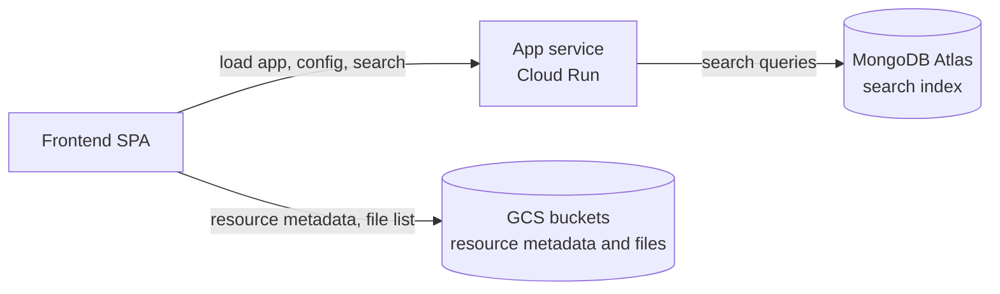

# Read-Only HydroShare POC: Technical Design (Atlas-backed)

Status: draft for review. No code has been changed.

## Purpose and context

This is no longer an emergency mode. Emergency needs are covered by a separate, very basic static HTML page
listing public resources, because the goal there is a cost as close to $0 as possible.

This design is a proof of concept (POC) of a much lighter-weight HydroShare that does only read-only,
repository-only functions. The existing Django application is cumbersome and carries years of legacy that is
hard to disentangle. The POC is meant to become a base that features such as edit and download can be added
back to, one at a time. It is the detailed design for Option 3 of
[preservation-only-mode-design.md](preservation-only-mode-design.md), which compares the earlier alternatives
(that document was written with the emergency motivation in mind).

Principles:

- **POC shortcuts are acceptable**, but each one is recorded (see "Follow-ups (not in current scope)") so
  it can be replaced later. Where there is a choice, do what is easiest now without closing off the follow-up.
- **Configurable by environment variables.** Behavior (for example read-only) and branding come from
  environment variables, not code changes (see "Configuration").
- **Single-tenant.** One deployment serves one organization. Logos and organization-specific text are
  configuration, not tenant logic.
- **Lightweight and low cost.** Few moving parts and little infrastructure. The target is under $300 per month
  to run, excluding storage (Atlas is about $80 of that). This is not the $0 goal of the emergency page.

POC definition and success criteria:

The POC is a read-only, repository-only HydroShare deployment that:

- is configurable, so it could be deployed with completely different branding
- can search resources and show a resource landing page
- includes an app landing page (home)
- allows no downloads and no edits
- has no authentication

A user should be able to use it the way they use HydroShare today, with limited functionality, and it should
cost under $300 per month to run excluding storage.

Scope of this design:

- **No authentication.** No login, sessions or "my resources".
- **Non-private resources only.** Public and discoverable resources, which is what the Atlas discovery index
  already contains. Private resources are not shown anywhere.
- **App home page, search, and a read-only resource landing page.** The landing page is rendered from the schema.org
  JSON-LD metadata file (`dataset_metadata.json`) read by the browser directly from GCS, with the file list
  also read directly from GCS, using the landing page work on the `6016-dedicated-landing-page` branch
  (confirm this is the branch; it is 105 commits ahead of `develop`). It shows only what is in the file and the
  bucket, and the README preview is omitted. Information that exists only in the database is dropped.
- **Repository-only.** No create, edit, share, publish, copy, delete, upload or download for anyone.
  Admins retrieve data directly from GCS with IAM, outside the application.

Sizes are relative (S, M, L), not time estimates.

## Solution overview

The POC does not use the Django application, its database, caches or workers. One small service serves the
existing Discover SPA (built in a read-only mode) and a read-only search API over the existing MongoDB Atlas
discovery collection. The landing page needs no API: the SPA reads each resource's `dataset_metadata.json` and
lists its files directly from GCS, using a read-only service account credential. The service is reached
directly on its Cloud Run URL (a custom domain is optional), with no load balancer, since this is a POC (if it
were productionized, it would move to the existing domain; see Follow-ups). It reads live data from the beta
environment, which is a separate GCP project: the beta Atlas database and the beta buckets.



### Read paths

- **Search and typeahead:** the browser calls the service, which queries the Atlas discovery collection.
- **Landing page (`/resource/<id>/`):** the service only delivers the SPA. The SPA then reads
  `<id>/.hsjsonld/dataset_metadata.json` and lists `<id>/data/contents/` directly from GCS through its
  S3-compatible API (the landing page already uses the AWS S3 SDK for this), authenticating with a read-only
  service account credential. No service endpoint and no Atlas are involved.
- **Configuration:** at startup the SPA fetches `/config.json` from the service, which builds it from
  environment variables (read-only flag, branding, endpoints). See Configuration.

### What the POC includes and excludes

| Included | Not used or deployed |
|---|---|
| New `hs_discover_api` service, the read-only Discover SPA, MongoDB Atlas (beta database with the existing index structure), the beta GCS buckets (existing data layout) | Django web service, Cloud SQL, Redis, Celery workers, Companion, `hs_s3_auth`, `hs_s3_proxy`, Keycloak |

The POC is built beside the existing application and reads data it already produced (the beta Atlas database
and the beta buckets). It does not modify the existing application. Retiring the existing application is out of
scope (see Follow-ups).

### Out of scope

- Any login, session or per-user behaviour.
- Private resources (they are not indexed and not served).
- File contents: downloads, previews (including the README preview), bags and zips.
- Writes of any kind, including DataCite POST and PUT.
- The emergency-mode static page (a separate effort).
- Replacing or decommissioning the existing production application.

Items that are deferred rather than excluded are listed in Follow-ups.

## Data model and schema changes

### Django and Postgres

No model or migration changes. The Django application is not modified. It stays the source of truth that
produced the Atlas index and the GCS objects the POC reads. If the index needs refreshing, use the existing
application's `update_discovery_index` command (see Dependencies).

### MongoDB Atlas `discovery` collection

The POC uses the beta environment's database. The collection is used only for search and typeahead. Documents are the contents of each resource's
`dataset_metadata.json` plus fields added by `collect_file_to_catalog`
([hs_core/hydroshare_atlas_discovery_collection.py](../../hs_core/hydroshare_atlas_discovery_collection.py)):
`_s3_filepath` and `first_creator`. Date strings are parsed to datetimes on ingest. The landing page does not
read from this collection.

| Change | Needed? | Notes |
|---|---|---|
| New document fields | No | No visibility or access fields are needed because private resources are not indexed. |
| `fuzzy_search` Atlas Search index definition | No | Unchanged. |
| Read-only database user | Yes (access control, not schema) | A dedicated user with read-only access to the discovery collection for the new service. |

Old (replaced) versions are not in this collection today (see Follow-ups).

### Other data

- **GCS buckets:** objects are unchanged. New configuration only: a read-only service account credential for
  the SPA, and CORS on the buckets so the browser can call them (see Security). No identity can write.

## API or contract changes

The new service exposes a small read-only API under `/api`. Search and typeahead use the same query
parameters and response shape as the existing Django endpoints in
[hs_rest_api/discovery_atlas.py](../../hs_rest_api/discovery_atlas.py), so the search page and the query
builder port need no functional changes. Only the base URL differs: the SPA's `API_BASE`
(`VITE_APP_API_URL`, currently `https://<domain>/hsapi/discovery-atlas`) is set to `https://<domain>/api`.

| Method and path | Description |
|---|---|
| `GET /api/search` | Search, with the same query parameters and response as the existing endpoint. The query builder is ported from Django. |
| `GET /api/typeahead` | Typeahead, with the same contract as the existing endpoint. |
| `GET /config.json` | Public runtime configuration built from environment variables (read-only flag, branding, endpoints, and the read-only storage credential the browser uses). Never includes any other secret, such as the Atlas connection string. |
| `GET /healthz` | Liveness: returns 200 if the process is up. Does not call Atlas, so an Atlas outage does not cause instance restarts. |
| `GET /readyz` | Readiness: pings Atlas. Used for the Cloud Run startup probe, the post-deploy check and the uptime check. |

Only GET routes are defined, so any other method returns 405 and unknown API paths return 404 (FastAPI
defaults). The service also serves the SPA's static files, falling back to `index.html` for any other path.
Those paths are frontend routes, described under User interface, not API endpoints.

Notes:

- No CORS configuration is needed for the API because the SPA and API share an origin. The GCS buckets do
  need CORS for the browser's direct requests.
- Frontend changes: `API_BASE` points at `/api`. The landing page's `fetchResource` and its file listing
  (`readRootFolder`) currently go through the S3 proxy with the user's session cookie (`${S3_PROXY_URL}`,
  `createCookieS3Client`). In the read-only build they point at GCS's S3-compatible endpoint with the read-only
  credential instead, with no new API. See User interface for the routes.
- The branch's landing page also calls the old Django API for things the POC does not have:
  `User.getResourceBucket` (which appears to call `/hsapi/resource/s3/{id}/` to find the bucket that holds a
  resource), `User.checkLoginStatus` (`/hsapi/userInfo/`) and `User.getCSRFToken` (`/csrf-cookie/`). The
  read-only build drops the login and CSRF calls. HydroShare spreads resources across several buckets (zones
  such as `hydroshare` and `published`, see `RESOURCE_S3_ZONES_CONFIG` in
  [hydroshare/settings.py](../../hydroshare/settings.py#L495)), and the old code looked up in the database
  which one holds a given resource. The Atlas record keeps only the key (`_s3_filepath`), not the bucket. For
  the POC the SPA chooses the bucket from the metadata: `creativeWorkStatus.name` equal to `Published` means
  the published bucket, anything else the resource bucket. A link to `/resource/<id>/` has only the ID, and
  the status lives in the file the SPA is about to read, so it tries the published bucket first and then the
  resource bucket (at most two requests). If the status is already known (for example when navigating from a
  search result), it can go straight to the right bucket. Resources in other zones (for example a community
  bucket) are not supported in the POC.

## Key components

| Component | Responsibility | New or existing |
|---|---|---|
| **Discover SPA (read-only build)** | App home page, search page and read-only landing page, served at the root. The landing page reads metadata and the file list directly from GCS and shows only file-backed information. Behavior and branding come from `/config.json`. Hides every edit and download affordance when read-only. Storage access is isolated in one module so it can later use presigned URLs. | Existing, plus the landing page branch, with a runtime read-only setting |
| **`hs_discover_api` service** | FastAPI app that serves search and typeahead (Atlas), runtime configuration and the SPA static files. Stateless. Reads from Atlas only and does not touch GCS. | New, in the new repository (see Repository and deployment), laid out after `hs_s3_auth` |
| **Query builder (`SearchQuery`)** | Turns query parameters into the Atlas `$search` pipeline. Copied from `hs_rest_api/discovery_atlas.py` with Django parts replaced (`request.GET`, `JsonResponse`, `settings.SEARCH_BOOST_*`, swagger). | Ported |
| **Mongo client** | Small `pymongo` client for search and typeahead. Reads the secret from Secret Manager. Does not import `hs_core` (which builds a boto3 client on import). | New |
| **Runtime configuration** | Environment variables validated at startup and exposed to the SPA as `/config.json`. Controls read-only behavior and single-tenant branding. | New |
| **Read-only GCS credential for the SPA** | A dedicated service account with read access to the buckets, used by the SPA through the S3-compatible API (an HMAC key built into the SPA bundle, or anonymous access if organization policy allows public grants). Treated as public. | New |
| **MongoDB Atlas** | Stores the discovery collection and the Atlas Search index. | Existing |
| **Index refresh (`update_discovery_index`)** | Optional pass in the existing application that makes the Atlas index match the discoverable and public resources in Postgres. Run it before the POC reads the index, if needed. | Existing management command |
| **Terraform (`terraform/` in the new repository)** | Resources for the new service, its secrets and environment variables, and an optional custom domain mapping. | New |
| **GCS buckets** | Preserved data. Read-only IAM. CORS for the browser. Admin retrieval is direct. | Existing, CORS added |

Port notes for the service (see [preservation-only-mode-design.md](preservation-only-mode-design.md) for the
framework discussion): `SearchQuery` is already a plain pydantic model, so most of the port is mechanical.
Relevance boosts and the score threshold (`SEARCH_BOOST_*`, `SEARCH_RELEVANCE_SCORE_THRESHOLD` in
[hydroshare/settings.py](../../hydroshare/settings.py#L989)) move to environment-based config. The copy is
deliberate: importing from `hs_rest_api` would pull Django into the image.

## Repository and deployment

The POC lives in its own repository, with the application and its infrastructure together, organized the way
[CUAHSI/FIMBox](https://github.com/CUAHSI/FIMBox) is. FIMBox is a reference for the overall shape, not a
template: where it differs from current industry practice, this design follows current practice (see
Engineering practices). Reasons:

- The SPA needs substantial changes (runtime configuration, root routing, home page, read-only mode, a single
  storage module, removal of Django-specific parts). Making them in this repository would add mode switches to
  the production Discover app.
- The production SPA is stable and not getting new features, so there is little to port back and forth after
  the copy.
- The point of the POC is to be decoupled from the Django codebase, and a separate repository makes that
  boundary real. It can be handed off, evolved or discarded without touching production.
- It can have its own CI, releases and Terraform.

### Proposed layout

```text
.ai/docs/            design documents (this document moves here)
AGENTS.md            guidance for coding agents
README.md            quick start and an index of guides
.env.example         every configuration variable, no secrets
docker-compose.yml   local stack: service, SPA, Atlas-compatible MongoDB
docker/              Dockerfile(s)
service/             FastAPI service (search, typeahead, /config.json, static files)
frontend/            the Discover SPA, extracted with history
terraform/           Cloud Run, IAM, secrets, Artifact Registry
scripts/             build-and-push image and deploy helper (or a Makefile)
tests/               service unit tests, manual test checklist
.github/             CI workflows (tests and checks), dependency update configuration, CODEOWNERS
```

### Engineering practices

Where FIMBox's approach is sound it is kept (flat Terraform files by concern, secrets populated outside
Terraform, a `docker-compose.yml` for local development, an example configuration file). Where current
practice is better, that is used instead. This is based on FIMBox's repository page and `terraform/README.md`;
its CI workflows were not visible, so check `.github` there before assuming anything about its CI.

| Area | Practice | Difference from FIMBox |
|---|---|---|
| Terraform state | Remote state in a versioned GCS bucket with locking, from the first apply, one backend key per environment. | FIMBox applies from a local directory and advises remote state only for production. |
| Terraform environments | Committed, non-secret `<env>.tfvars` files (beta now). Secrets never go in tfvars. | FIMBox uses a local, untracked `terraform.tfvars`. |
| Image build | Built and pushed by a script run locally (as in FIMBox), tagged with the git SHA (immutable), refusing to run on a dirty working tree, and deployed by digest. | Similar to FIMBox's local script, with SHA tags and a clean-tree guard. |
| Deploy flow | Manual, for rapid development (this matches how production is deployed today). Terraform owns infrastructure and the image digest is passed as a variable (`terraform plan`, review, `apply`). The first apply uses a placeholder image, so there is no two-phase `deploy_services` toggle. | FIMBox uses a two-phase boolean. |
| Access to GCP | Operators use their own credentials or an impersonated deploy service account, never downloaded keys. Separate deploy and runtime service accounts with least privilege. CI has no GCP access for now. | Not visible in FIMBox. |
| CI | Runs tests and static checks only (`pytest`, `ruff`, type checks, `eslint`, `vitest`, `vue-tsc`, `terraform fmt -check` and `validate`, dependency scanning). Deploying from CI, using Workload Identity Federation, is a later option. | Not visible in FIMBox. |
| Secrets | Secret Manager, populated outside Terraform, injected into Cloud Run. | Same as FIMBox. |
| Python tooling | `uv` with `pyproject.toml` and a lockfile, `ruff` for lint and format, `mypy` or `pyright`, and `pytest`. | FIMBox uses pixi, which is aimed at conda packages. This service has only pure Python dependencies. |
| Frontend tooling | Node LTS pinned, lockfile committed, `eslint`, `prettier` and `vue-tsc`, `vitest` for unit tests. Browser end-to-end tests are out of scope for the POC. | Not applicable. |
| Containers | Multi-stage builds, slim base image pinned by digest, non-root user, a health check and a `.dockerignore`. | |
| Dependencies and supply chain | Dependabot or Renovate, vulnerability scanning of dependencies and images (for example Trivy), secret scanning, and an SBOM from the build. | |
| Terraform quality | `terraform fmt -check`, `validate`, `tflint`, IaC scanning (for example Trivy config or Checkov), and pinned Terraform and provider versions with the lock file. | FIMBox runs fmt, validate and mock-provider tests. |
| Git hygiene | pre-commit hooks (`ruff`, `eslint`, `terraform fmt`), branch protection with required CI checks, and CODEOWNERS. | |
| Decisions | Short architecture decision records for choices like these, next to the design documents. | |

Minimum for the POC: remote Terraform state, a build-and-push script and a documented manual deploy, CI for
tests and static checks, `uv` with `ruff` and `pytest`, `eslint` and `vitest`, `terraform fmt -check` and
`validate`, and Dependabot. The rest can be added as the project matures.

### What is copied, and how

| Source in the Django repository | Into the new repository | How |
|---|---|---|
| `discovery-atlas/frontend` (from the landing page branch) | `frontend/` | Extract with history (`git subtree split`, or `git filter-repo --subdirectory-filter`) so log and blame are preserved. Pin `@cznethub/cznet-vue-core` to a published version instead of a local link. |
| `hs_rest_api/discovery_atlas.py` | `service/` | Copy the single file and port it. Put the source commit in a header comment. While porting, compare a few queries by hand against the Django endpoint (a one-time check, see Testing). |
| `hs_s3_auth` | none | Layout reference only. |

Record the source commits in the README (provenance) so later comparisons are possible.

### Infrastructure and deployment

- Terraform in `terraform/` deploys into the beta GCP project. One small change to `platform-recipes` is
  needed for the POC (CORS on the zone buckets, below). Everything else is in the new repository. If the POC is
  productionized, the module can be referenced from `platform-recipes` or moved there.
- **What the new repository's Terraform owns for storage access:** the read-only service account, its HMAC key
  (the secret is stored in Terraform state, so restrict access to the state bucket), and additive IAM bindings
  on the existing buckets (list, and get restricted to `.hsjsonld/`), referencing the buckets by name. Bucket
  IAM members are additive, so they do not conflict with the bindings `platform-recipes` manages.
- **What stays in `platform-recipes`:** CORS, because it is an attribute of the `google_storage_bucket.zones`
  resource that stack owns, and two stacks cannot manage it. The existing rule already allows `GET` and
  `HEAD`. Two changes are needed:
  - add the POC's origin (the Cloud Run URL or custom domain) to `resource_cors_allowed_origins` in the dev
    stack's `terraform.tfvars` (prod uses `["*"]`, and the dev default is `[]`, which allows no origin)
  - add the headers a signed S3 SDK request sends (`Authorization`, `x-amz-date`, `x-amz-content-sha256`,
    `x-amz-user-agent`, and any others the SDK adds) to the rule's `response_header` list, which GCS also
    checks against the preflight's requested headers (verify)

  The same rule covers all three zone buckets (`hydroshare`, `published`, `ciroh`), so this also affects the
  existing application's buckets in that environment. Try the change with `gcloud storage buckets update
  --cors-file` on one bucket before editing Terraform.
- Remote Terraform state in a versioned GCS bucket in the beta project, with locking, from the first apply.
- Deployment is manual for now, for rapid development, as production is today. CI runs tests and checks only.
  A deploy is: run the tests, build and push the image with the script (git SHA tag, clean working tree),
  `terraform plan` and review, `terraform apply` with the new image digest, then check `/readyz` and a smoke
  search.
- Deploying from CI (with Workload Identity Federation instead of stored keys) can be added later without
  changing the layout.
- The Atlas connection string and other secrets live in Secret Manager and are populated outside Terraform.
- Cloud Run environment variables are set from Terraform variables and match the Configuration section.
- **Access during development.** The service is not public while the POC is being built. A Terraform variable
  (for example `public_access`, default `false`) controls whether the `allUsers` `roles/run.invoker` binding
  exists. With it off, only named people or a group hold `run.invoker`, anonymous requests get a 403 from Cloud
  Run, and the team reaches the service with `gcloud run services proxy`. Setting it to `true` makes the
  service public, as FIMBox is. If reviewers without GCP access need to see it before then, add IAP on Cloud
  Run or a shared-password check in the app. Probes are unaffected, but an external uptime check needs an
  identity token while the service is private. This also keeps the public storage credential in `/config.json`
  from unauthenticated visitors until launch.

## Configuration

Behavior and branding are controlled by environment variables read by the service at startup and validated:
missing or invalid required values stop startup with a clear message. One deployment is one tenant. There is
no tenant selection in code, and per-organization differences are configuration only.

### How configuration reaches the SPA

The service exposes a public `GET /config.json` built from environment variables.

This follows the usual twelve-factor approach: configuration lives in environment variables that are typed and
validated at startup (for example with pydantic settings), and secrets come from Secret Manager, never from
files in the repo. For local development an untracked `.env` file (with a committed `.env.example` listing
every variable) supplies the same variables. A browser app cannot read the server's environment at runtime,
and build-time `VITE_*` variables bake values into the build, so the service publishes the public subset as
`/config.json` and the SPA loads it at startup. This is the common pattern for a configurable static SPA.

The SPA fetches `/config.json` before mounting, so the same built image works for any configuration, and booleans and structured values are
supported. The existing frontend container instead replaces `VITE_APP_*` placeholders in the built files when
it starts (`docker-entrypoint.sh`, with matching placeholders in `.env.production`). That works for plain
strings but skips empty values and needs a new placeholder for every setting. Use `/config.json` for new
settings and leave the existing `VITE_APP_*` values alone to limit change. Everything in `/config.json` is
public. Secrets never go there.

### Proposed variables (initial list, names to be confirmed)

| Variable | Purpose | In `/config.json` |
|---|---|---|
| `READ_ONLY` (default `true`) | The service accepts only GET requests (405 otherwise) and the SPA hides edit and download controls. The POC supports only `true`. The flag sets the pattern so features can be enabled later without a rebuild. | Yes |
| `ENABLE_FILE_DOWNLOAD`, `ENABLE_AUTH`, `ENABLE_EDITING` | Reserved for later. Not implemented in the POC. | Yes |
| `NOTICE_TEXT` | Banner text. Empty means no banner. | Yes |
| `APP_NAME`, `ORG_NAME` | Name shown in the title, header and text. | Yes |
| `LOGO_URL`, `FAVICON_URL` | Branding images. | Yes |
| `THEME_PRIMARY_COLOR` (and other theme colors) | Theme overrides. | Yes |
| `CONTACT_EMAIL` or `SUPPORT_URL` | Contact shown in the banner and footer. | Yes |
| `HOME_INTRO_TEXT` | Intro text on the app home page (Markdown). | Yes |
| `HOME_CAROUSEL` (JSON) | Carousel slides on the home page: image URL, title, caption and an optional link per slide. | Yes |
| `FOOTER_TEXT`, `FOOTER_LINKS` (JSON) | Footer text and links. | Yes |
| `PUBLIC_BASE_URL` | Base URL of the deployment. | Yes |
| `STORAGE_ENDPOINT_URL`, `STORAGE_BUCKET_RESOURCE`, `STORAGE_BUCKET_PUBLISHED`, `STORAGE_ACCESS_KEY_ID`, `STORAGE_SECRET_ACCESS_KEY` | GCS S3-compatible endpoint, the two buckets (default zone and published zone) and the public read-only key the SPA uses (a recorded shortcut). | Yes |
| `ATLAS_CONNECTION_URL` | Atlas connection string. Secret (Secret Manager). | No |
| `ATLAS_DB_NAME`, `ATLAS_COLLECTION` (`discovery`), `ATLAS_SEARCH_INDEX` (`fuzzy_search`) | Where search reads from. | No |
| `SEARCH_BOOST_*`, `SEARCH_RELEVANCE_SCORE_THRESHOLD` | Relevance tuning (defaults from the Django settings). | No |
| `LOG_LEVEL`, `PORT` | Service operation. | No |

## Follow-ups (not in current scope)

These are deferred on purpose. Nothing here blocks the POC.

### Shortcuts to replace

| Shortcut in the POC | Planned follow-up |
|---|---|
| The SPA reads GCS directly with a public read-only credential | The service returns short-lived presigned URLs for the metadata file (and listings) after checking the resource. This removes the public credential, allows private-resource gating and a README, and is the natural seam for downloads. Keep storage access in one SPA module so the swap is local. |
| No authentication | Add OIDC login in the service, then visibility filtering and "private to me" as described in the earlier design. |
| Landing page picks the bucket from the published status, trying the published bucket first for direct links | Store the full path (bucket and key) in the Atlas record. Without the bucket the record is not enough to locate a resource's files, so the SPA would no longer infer or try buckets. A service endpoint or the presigned URL flow could also return the bucket and keys. |
| Recursive client-side file listing | Flat or paginated listing through the service. |
| README not shown | Served through a presigned URL once the credential is no longer public. |
| `READ_ONLY` supports only `true` | Implement write paths behind the reserved flags, one at a time (for example download first). |

### Other follow-ups

- **Private metadata exposure (hardening).** The public credential can list the buckets and read any
  resource's metadata file, including private resources' (title, abstract, creators). Exposing private file
  names is accepted. The metadata exposure is accepted for the POC. Fix it with presigned URLs from the service
  (so the service can check visibility), or by exposing only public and discoverable metadata files.
- **Replaced versions.** Old versions are not in the search index, but their landing pages still render by
  URL if the metadata file exists. Add a "replaced by a newer version" notice (from the relations in the
  metadata) and decide how old versions appear in search.
- **JSON-LD tag for search engines.** Build the JSON-LD `<script>` tag from the metadata file contents so
  crawlers and Google Dataset Search can index landing pages. The Django pages did this (see branch
  `6487-json-ld-tag-generation`); a client-rendered SPA may not be indexed the same way.
- **Analytics.** Usage analytics (page views, searches), which would be needed if the POC were productionized.
  Cloud Run request logs only for now.
- **README preview.** Needs a way to read one file's contents without opening up all contents (presigned URL).
- **Productionizing at the existing domain.** DOI linkage and the DataCite relationship, refreshing the index
  from the full application, retiring the existing application and a rollback plan.
- **Load balancer.** Add a global external load balancer with Cloud CDN and Cloud Armor (rate limiting, WAF),
  a custom domain with a managed certificate, and Cloud Run ingress restricted to the load balancer, if abuse
  control, caching or an existing-domain deployment need them. Until then the service uses its Cloud Run URL
  or a custom domain mapping, as FIMBox does with its Cloud Run URL.
- **Static files for production.** The POC serves the SPA's static files from the same Cloud Run service as the
  API, which keeps it to one service, one URL and no CORS. For production, move the built SPA to a bucket behind
  the load balancer with Cloud CDN, and leave the service with only `/api`, `/config.json` and the health
  endpoints. This gives edge caching, no cold-start wait for the page shell, frontend deploys that are
  independent of the service, less static traffic on the service, and bot traffic absorbed by Cloud Armor. It
  needs SPA fallback to `index.html` configured on the load balancer, CORS or path-based routing so `/api`
  still reaches the service, and a separate frontend deploy step (with `config.json` still coming from the
  service).
- **Search payload.** Project only the fields the result cards use instead of returning the full document.
- **Caching.** Deferred. Options when it is needed: `Cache-Control` headers on search and typeahead responses,
  a short in-memory cache in the SPA's storage module for metadata files and listings (the POC reads live
  data, so TTLs must be short), `Cache-Control` metadata on the GCS objects (set by the application that
  writes them), long-lived caching of the fingerprinted static assets, and a CDN (needs the load balancer).

## User interface

The SPA has three views, an app home page, a search page and a resource landing page, all inside the existing
Discover SPA, served directly from the root of the deployment's domain (no Django shell or iframe).

### Routes

| Path | View |
|---|---|
| `/` | App home page |
| `/search/` | Search page |
| `/resource/:resourceId` | Resource landing page. The same path HydroShare uses, so resource URLs match. |

The service serves the SPA's `index.html` for these paths, and for any other non-API path, so deep links and
reloads work. The SPA is built to be served at the root (`VITE_APP_BASE=/`, currently `/discover/`), and the
landing route moves from `/resource-v2/:resourceId` to `/resource/:resourceId`. `/discover/...` URLs are not
kept (new domain).

### Branding and notice

The header, footer, title, logo, favicon, theme colors and any organization-specific wording come from
configuration (see Configuration), not from code. An optional banner (text from configuration) explains that
this deployment is read-only, with a link or contact for questions. Wording and contact are product decisions
(see Open Questions).

### App home page

A small landing page for the app, like the one at https://www.hydroshare.org/landingPage/ but simpler:

- a header with the configured name and logo, with a way to reach search
- a carousel whose slides come from configuration (`HOME_CAROUSEL`)
- intro text from configuration (`HOME_INTRO_TEXT`)
- a footer from configuration (`FOOTER_TEXT`, `FOOTER_LINKS`)

The exact content and layout are still to be worked out (see Open Questions).

### Search page (existing)

- Free-text search with fuzzy and autocomplete matching, sort, and the existing filters.
- Result cards link to the landing page (`/resource/:resourceId`), now that it exists.
- No login or "private to me" filter. Only public and discoverable resources appear.

### Resource landing page (read-only)

Built from the landing page branch. The runtime `readOnly` setting from `/config.json` (from the `READ_ONLY`
environment variable) removes anything that edits or downloads. A build-time flag is not used, so the same
image can later run with features enabled:

- **Shown:** title, authors, abstract, keywords, coverage, funding, license, relations, DOI and citation,
  sharing status, and other fields from the JSON-LD metadata.
- **Hidden or removed:** Edit button and the `edit-dataset` route, Manage access, delete resource (calls
  `/hsapi/_internal/...`), uploads (`hs-uppy`), file actions, and bag and zip downloads (`bag-download.ts`,
  `zip-download.ts`).
- **Data loading changes:** the branch already reads `dataset_metadata.json` (`fetchResource`) and lists files
  (`readRootFolder`, a recursive S3 `ListObjectsV2`) from the browser. The read-only build keeps this and
  points the S3 client at GCS with the read-only credential instead of the S3 proxy with cookies. The file
  explorer keeps working with its download and upload actions removed. The README preview (`readme-s3.ts`)
  is omitted because it reads file contents (see Follow-ups).
- **Exclude database-only information:** the page must show only what is in the metadata file. Anything that
  exists only in the database is removed or hidden. From the current shell and page this includes alerts, the
  owner list, creator profile links (`hs_user_id`, profile cards), view and download counts, the bag URL and
  anything derived from the signed-in user. Audit every field the page reads against the contents of
  `dataset_metadata.json` to find the rest.
- **Not available state:** a resource whose metadata file cannot be read (no such ID, or deleted) shows a
  clear message that the resource is not available in this read-only deployment.

## Additional Considerations

### Security

- **Authentication and authorization:** none. There are no users, sessions, cookies or CSRF tokens. The
  search API serves only indexed data (public and discoverable resources). The landing page reads GCS
  directly, so what it can reach is decided by the credential's IAM scope (see below).
- **Data exposure, search:** the control is what is in the index. Only `discoverable` or `public` resources
  are indexed (`public` implies `discoverable` in
  [hs_core/models.py](../../hs_core/models.py#L2837)). Verify that no private resource has a document in the
  index the POC uses (a check against the matching Postgres before the POC is released).
- **GCS credential (browser-side):** the SPA reads GCS directly with a dedicated read-only service account
  (an S3-compatible HMAC key in the SPA bundle), or anonymously if organization policy allows public grants.
  Either way, treat it as public: every visitor can use it. Scope it to the minimum:
  - list (`storage.objects.list`) on the resource and published buckets, for the file explorer
  - read (`storage.objects.get`) only on `.hsjsonld/` objects, restricted with an IAM condition on the object
    name (verify the exact expression), so file contents under `data/contents/` cannot be read
  - no write permissions anywhere
- **Data exposure, landing page:** the buckets contain private resources too, and there is no server-side
  gate. Because the credential can list the buckets, anyone can enumerate every resource ID (including
  private ones) and its file names, and can read any resource's `.hsjsonld/dataset_metadata.json` by ID,
  including private ones. Exposing private file names is accepted. Exposing private resources' metadata
  (title, abstract, creators) conflicts with "non-private resources only". This is accepted for the POC and
  recorded as a hardening follow-up (see Follow-ups).
- **Public credential abuse and cost:** requests and egress are billed to the project. Mitigate with request
  quotas and budget alerts, rotate the key if abused, and consider serving metadata files through a CDN (see
  Follow-ups).
- **CORS:** the zone buckets already have a CORS rule in `platform-recipes` (see Infrastructure and
  deployment). It must allow only the app's origin (the Cloud Run URL, or the custom domain if used) for GET
  and HEAD and the headers the S3 SDK sends. Prod currently allows all origins (`*`).
- **Read-only everywhere:**
  - the API accepts only GET (405 otherwise)
  - the Atlas user is read-only on the discovery collection
  - GCS resource and published buckets get a read-only IAM binding so no identity can write
- **Secrets:** the Atlas connection string comes from Secret Manager (the existing `atlas-url` secret or a new
  read-only one). Nothing is committed to the repo or the image. Public values (branding, the storage key) go
  in `/config.json`, and secrets never do. Note that the platform-recipes repo currently
  contains committed plaintext secrets for other components (flagged earlier); do not follow that pattern.
- **Network:** confirm how Cloud Run reaches Atlas. Cloud NAT is configured with automatic (ephemeral) IPs, so
  an IP allowlist would not hold. Determine whether Atlas allows broad access today, and whether the new
  service should use Private Service Connect or a static NAT address.
- **Transport:** TLS terminates at Cloud Run (HTTPS on the Cloud Run URL or a custom domain). Atlas
  connections use TLS (`mongodb+srv`).
- **Abuse and cost:** once public, the service has no load balancer (an `allUsers` invoker, as in FIMBox), so
  set Cloud Run max instances, enforce pagination limits on search, and add modest rate limiting in the app.
  Cloud Armor needs a load balancer (see Follow-ups).
- **Admin data access:** direct GCS or S3 access with manually managed IAM roles, by named admin identities,
  with a written runbook. The old S3 access key flow goes away with `hs_s3_auth`.

### Performance

- **Expected load:** unknown, and likely lower than the full application's. The data is read-only from the
  POC's side, which is favorable.
- **Search:** Atlas Search with fuzzy and autocomplete is the same workload as today. The search endpoint runs
  an aggregation, then a `$lookup` back to the same collection to return full documents. That makes payloads
  large (full JSON-LD for each of up to 20 results). This is acceptable for parity at the start. Projecting
  only the fields the result cards use is an optimization to consider.
- **Landing page:** the browser makes one GCS read for the metadata plus list calls for the file tree. The
  existing explorer lists recursively (one `ListObjectsV2` per folder), so deep or large trees take several
  round trips. Caching is out of scope (see Caching below). A single flat list per resource (no delimiter) is an
  optimization if large trees are slow.
- **Caching:** out of scope for the POC. The service sets no caching policy of its own for search and
  typeahead, and the SPA does not cache metadata or listings, so every read goes to Atlas or GCS and data is
  always current. Any default browser caching of the built static files is left as is. See Follow-ups.
- **Cold starts:** a small FastAPI image starts quickly. Setting min instances to 1 removes cold starts at low
  cost, and 0 is acceptable if cost matters more.
- **Cost:** the target is under $300 per month excluding storage. Atlas is about $80 per month today and runs
  outside GCP billing. The other recurring items are Cloud Run (a small service, minimum instances 0 or 1),
  egress and logging, with no load balancer cost. These should
  fit well within the target, but this has not been estimated precisely: confirm with the GCP pricing
  calculator once the Cloud Run sizing and expected traffic are known.
- **Concern:** the `$search` relevance threshold and sorting are unchanged, so latency should match the
  current endpoint. Measure it by hand with realistic queries (see Testing).

### Observability

- **Logging:** structured JSON to Cloud Logging. Fields: request ID, method, path, status, latency, search
  parameters (no personal data, and avoid logging client IPs) and Atlas query duration. Landing page reads happen in the browser, so the service cannot see them: use GCS
  request metrics and, if enabled, Data Access audit logs, and consider lightweight frontend error reporting to
  catch missing resources.
- **Metrics:** use Cloud Run built-in metrics (request count, latency, instance count, 5xx). Add custom
  counters for search requests, zero-result searches and resource 404s if needed.
- **Atlas metrics:** connections, operation latency and Atlas Search status, with Atlas alerts.
- **Alerts:**
  - 5xx rate and p95 latency on the service
  - uptime checks on `/readyz` and on a representative search
  - Atlas connection or availability alerts
  - GCS 4xx and 5xx rates and request volume (Cloud Monitoring storage metrics), which also reveals abuse of
    the public credential
- **Usage analytics:** view and download counts and `hs_tracking` are gone. Cloud Run request logs only for
  now. Analytics are a follow-up (see Follow-ups).

### Testing

For a POC the approach is a small set of fast unit tests for logic that is easy to get wrong, and a written
manual checklist for everything that touches real infrastructure. Automated integration and end-to-end tests
(a local Atlas container, browser tests, load tests) are out of scope and can be added if the POC is
productionized.

#### Unit tests (automated, run in CI)

- **Query builder:** the main logic in the service, tested directly with no database. For each input (a term,
  each sort option, each filter, pagination, and empty and invalid input), assert the `$search` pipeline the
  builder produces (the clauses, boosts, filters, sort, skip and limit) and that invalid parameters are
  rejected. These are ordinary tests that run on every change, so later edits to the query cannot silently
  break it.
- **Configuration:** the service fails fast on missing or invalid required variables, defaults apply, and
  `/config.json` contains only the public variables (and no Atlas connection string).
- **Routes with the Atlas client mocked:** search and typeahead return the expected shape for a canned result,
  non-GET methods return 405, unknown API paths return 404, and `/healthz` returns 200 without touching Atlas.
- **SPA logic, with `vitest`:**
  - the bucket selection from the published status (published bucket first, then the resource bucket)
  - the storage module's handling of a missing object
  - the read-only setting hiding the edit and download controls
  - the configuration-driven home page, footer and banner

#### Manual testing (against the beta environment)

These depend on real GCS, Atlas, IAM and a browser, so they are checked by hand before a release and recorded
in a short checklist in the repository:

- **Search:** a few real queries return sensible results, filters, sorting and typeahead work, and the zero
  result case looks right. Once, while porting, run the same queries against the Django endpoint and the new
  service and compare the results by hand.
- **Landing page:** open a published resource, a non-published resource, a resource with a deep or large file
  tree, and an ID that does not exist (shows the not available message). Confirm that no edit, manage, delete,
  upload or download controls appear and that no database-only information is shown.
- **Direct GCS access from the browser:** with the read-only credential, the S3 SDK's `ListObjectsV2` (with
  `Prefix` and `Delimiter`) works against GCS's S3-compatible API and returns the names, sizes and folders the
  explorer expects (verify `list-type=2` support), reading `.hsjsonld/dataset_metadata.json` works, and CORS
  preflights succeed. A missing object (the first bucket try for a resource that is not published) returns a
  404 the SPA can read, which requires CORS headers on error responses (verify; if they are missing the SPA
  sees a network error, and the bucket fallback must treat that the same as a 404).
- **IAM scope:** with the same credential, reading any `data/contents/` object and any write are denied.
- **Branding:** deploy or run with two different sets of branding values and confirm the name, logo, notice,
  colors, carousel and footer change, and that the read-only setting is on.
- **Visibility:** compare the Atlas index with Postgres once before release (a one-off query or script):
  every document corresponds to a discoverable or public resource.
- **Deployment and access:** after a deploy, `/readyz` passes, an anonymous request is rejected while
  `public_access` is off, and the Cloud Run logs show requests.
- **Rough performance:** try a few searches and a large landing page by hand and note the latencies. A formal
  load test is not part of the POC.

### Dependencies

Already in place, so not blockers: the beta GCP project, the beta Atlas cluster and database with its access
details, and the beta buckets. Work that is part of the POC itself and is planned in the milestones, not a
dependency: the new repository and its Terraform, CI and image builds, the read-only service account, its HMAC
key and bucket IAM bindings, the read-only Atlas database user, and confirming the network path from Cloud Run
to Atlas.

Gating or external to the POC:

- **Landing page branch** (`6016-dedicated-landing-page`, 105 commits ahead of `develop`): the SPA is copied
  from it, so it should be merged or otherwise stable at the copy point (needed for M2). The read-only mode is
  added in the new repository. It is currently a combined view and edit page that reads from S3 with cookie
  auth and depends on Django-provided data.
- **Decisions in Open Questions:** home page content and wording (needed for M4), and the landing page branch
  (needed for M2).
- **CORS change in `platform-recipes`:** add the POC origin to the dev tfvars and the S3 SDK request headers to
  the rule (see Infrastructure and deployment). This is a change in another repository, so it needs a PR and
  review there (needed for M3).
- **Organization policy:** confirm that the S3-compatible API and HMAC keys work for the new service account
  (the existing application already uses an HMAC key in its project).
- **Index refresh (only if needed):** `update_discovery_index` needs the full existing application and its
  `hs_extract` and `hs_event_s3` workers running.
- **Operational:** a written admin retrieval runbook (manually managed IAM roles for now).

### Milestones

Phases are ordered so that a working, deployed application exists from the first milestone and each later
milestone adds a slice to it. Each ends with something demonstrable.

1. **M0: Repository bootstrapping and a deployed skeleton (S to M).**
   Create the new repository (layout and provenance as in Repository and deployment) with the scaffolding:
   `AGENTS.md`, `README.md`, `.env.example`, `docker-compose.yml`, the Dockerfile, `uv` and `ruff`, lint and
   pre-commit hooks, Dependabot, CI for tests and checks, and the build-and-push script. The application is
   boilerplate only:
   - a simple Vue SPA with the three routes (`/`, `/search/`, `/resource/:resourceId`) and placeholder pages
   - a FastAPI service with a hello world endpoint (under `/api`), `/healthz`, and `/config.json`
   - one simple environment variable (for example the app name) that flows through `/config.json` and shows
     on a page, to demonstrate the configuration path
   - the service serving the built SPA, with fallback to `index.html`

   Wire it all up with the infrastructure: Terraform with remote state in the beta project, Artifact Registry,
   Cloud Run (private, per Access during development), and a manual deploy with the script. Done when the
   boilerplate is deployed to the beta project, reachable through `gcloud run services proxy`, and changing the
   environment variable and redeploying changes what the page shows.
2. **M1: API (M).**
   Replace the hello world endpoint with the real ones. Ported query builder and Mongo client, `/api/search`
   and `/api/typeahead`, and `/readyz`. Unit tests. The read-only Atlas user, the Atlas secret in Secret
   Manager, and the network path from Cloud Run to Atlas confirmed. Deployed to beta and tested there by hand
   against the real index (including the one-time comparison with the Django endpoint).
3. **M2: Search page (M).**
   Port the Discover app into the SPA as the search page, using the endpoints built in M1 (`API_BASE` set to
   `/api`). Extract the SPA from the landing page branch with its history. Runtime read-only setting hiding
   edit and download controls. Deployed to beta.
4. **M3: Resource landing page (M).**
   The file-based landing page: metadata and file list read directly from GCS behind a single storage module,
   bucket selection by published status, database-only information removed, and the not available state. The
   read-only service account, HMAC key and bucket bindings in Terraform, and the CORS change in
   `platform-recipes`. Manual GCS access, CORS and IAM checks. Deployed to beta.
5. **M4: Home page and branding (S to M).**
   Name, logos, favicon, theme colors, footer and notice, and the app home page (carousel, intro text, footer)
   all come from configuration. Verify with two sample configurations.
6. **M5: Harden and evaluate (S).**
   Logging, metrics and alerts, the full manual test checklist run against beta, and a security review of the
   public credential and Atlas access. Usage feedback and performance. Review the shortcuts list (presigned URLs
   first) and choose the next feature to add back (for example download or authentication).

### Open Questions

1. **Home page content and wording.** The app home page should be like https://www.hydroshare.org/landingPage/
   but simpler. What goes in the carousel (how many slides, where the images come from, captions and links),
   how long and in what format is the intro text, what does the footer contain, what are the default banner
   text and contact, and which other UI strings and theme elements must be configurable (name, logo, favicon,
   colors)? Is translation in scope?
2. **Landing page branch.** Is `6016-dedicated-landing-page` the right branch to copy the SPA from, and at
   what point (as it is, or after it merges)? This is a larger discussion still to be had.

